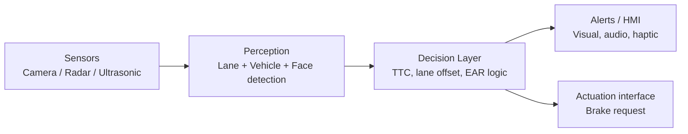

# Technical Design Document: ADAS Prototype

## 1. Goal
Reduce human-error road accidents by detecting hazards in real time and alerting the driver (or triggering braking) earlier than a human can react.

## 2. Architecture

## 3. Modules

### 3.1 Forward Collision Warning (`collision.py`)
- **Distance:** `d = (W_real x f) / w_pixels` (pinhole camera model).
- **TTC:** `closing_speed = (d_prev - d_now) / dt`, `TTC = d_now / closing_speed`.
- **States:** `SAFE`, `WARN` (TTC <= 2.5 s), `BRAKE` (TTC <= 1.2 s). Thresholds are configurable.

### 3.2 Lane Departure Warning (`lane.py`)
1. Grayscale, Gaussian blur, Canny edges.
2. Trapezoid region-of-interest mask on the road area.
3. Probabilistic Hough transform to find line segments.
4. Split by slope sign into left and right lanes, average each.
5. Offset = (image centre - lane centre) / lane width at the image bottom. `|offset| > 0.25` raises a departure warning.

### 3.3 Fatigue Monitoring (`fatigue.py`)
- EAR = (|p2-p6| + |p3-p5|) / (2|p1-p4|) over 6 eye landmarks.
- Eyes counted closed when EAR < 0.21; `DROWSY` after 1.5 s continuous closure (a normal blink does not trigger).

## 4. Data flow
`demo.py` reads frames, runs lane detection and lead-vehicle detection, updates TTC from consecutive distance samples, and renders the state onto the output video.

## 5. Testing
`tests/test_adas.py` (11 unit tests) covers distance and TTC maths, state classification, invalid inputs, lane offset on synthetic frames (centred, drifting, no lane), and fatigue logic (sustained closure vs blink).

## 6. Known limitations and next steps
- Replace the colour detector with a trained object detector.
- Calibrate camera intrinsics for accurate distance.
- Add radar/ultrasonic fusion and low-light handling.
- Port to embedded hardware and measure end-to-end latency.
